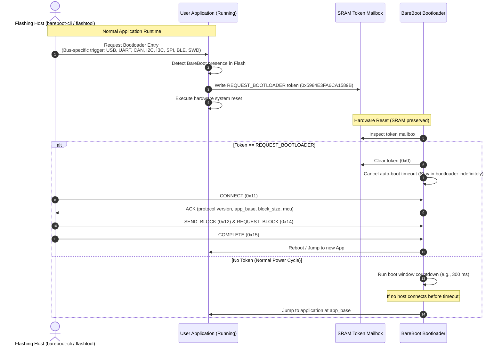

# Handsfree Application Updates with BareBoot

This document specifies the universal architecture, memory contracts, communication protocols, and code implementations for **handsfree application updates** using the BareBoot bootloader across all supported hardware interfaces.

Supported Interfaces:
1. **USB** (CDC 1200-baud touch, DFU Detach, Vendor Control Transfers)
2. **UART / Serial** (In-band magic tokens, framed break commands)
3. **CAN & CAN-FD** (Admin reboot broadcast, UUID addressing, 64-byte FD frames)
4. **I2C Target** (Host single-byte strobe `0xF0`, SMBus General Call, register writes)
5. **I3C Target** (MIPI CCC `RSTACT` Target Reset, ENTDAA/SETDASA, dynamic address `0xF0` strobe)
6. **SPI Target** (Chip-select strobes, magic sync command sequences)
7. **Debug Probe / SWD Mailbox** (Non-intrusive memory poke via CMSIS-DAP, ST-Link, WCH-Link)
8. **Wireless / BLE** (GATT OTA Control Point on CH58x / CH59x)

---

## 1. High-Level Architecture

Handsfree flashing allows updating device firmware over existing communication buses without requiring:
- Physical access to BOOT0 / BOOT1 pins or DIP switches.
- Hardware reset or boot buttons.
- External SWD/JTAG debug probes (ST-Link, WCH-Link, J-Link).

### Update Lifecycle



---

## 2. Katapult Reference Analysis (`ref/katapult`)

BareBoot maintains wire and protocol compatibility with Katapult (formerly CanBoot). In `ref/katapult`, support across different transports is structured as follows:

| Interface | Katapult Mechanism | Implementation in `ref/katapult` |
|---|---|---|
| **USB CDC** | 1200-baud touch (`termios.B1200` + DTR toggle) | `scripts/flashtool.py` (`_request_usb_bootloader`) |
| **UART Serial** | Magic string `~ \x1c Request Serial Bootloader!! ~` | `scripts/flashtool.py` (`_request_serial_bootloader`) |
| **CAN Bus** | Frame on ID `0x3F0` (`KLIPPER_ADMIN_ID`), payload `[0x02, uuid_0..5]` | `scripts/flashtool.py` (`_jump_to_bootloader`) |
| **I2C Target** | Host writes single byte `0xF0` to target I2C address | `scripts/flashtool.py` (`I2cSocket.run()`, line 1309) |
| **I3C Target** | SETDASA / ENTDAA dynamic address assignment + write `0xF0` | `scripts/flashtool.py` (`I3CInterface`, line 1334) |

### Cross-Reset RAM Mailbox
Katapult coordinates the handoff between application and bootloader using a 64-bit token stored at the top of SRAM:
- **Magic Request Token**: `REQUEST_CANBOOT = 0x5984E3FA6CA1589B`
- **Application Exit Token**: `REQUEST_START_APP = 0x7b06ec45a9a8243d`
- **Dynamic RAM Location**:
  In `ref/katapult/src/generic/armcm_link.lds.S`, Katapult allocates an 8-byte `.reserved` section immediately following the bootloader's stack:
  ```ld
  _stack_start = CONFIG_RAM_START + CONFIG_RAM_SIZE - CONFIG_STACK_SIZE - 8;
  .stack _stack_start (NOLOAD) : {
      . = . + CONFIG_STACK_SIZE;
      _stack_end = .;
  } > ram
  .reserved (NOLOAD) : {
      . = . + 8;
  } > ram
  ```
  The bootloader's initial stack pointer (`bl_vectors[0]`) points to `_stack_end`.
  An application can locate this token dynamically without hardcoding physical RAM boundaries:
  ```c
  void try_request_canboot(void) {
      uint32_t *bl_vectors = (uint32_t *)(CONFIG_FLASH_BOOT_ADDRESS);
      uint64_t *req_sig = (uint64_t *)bl_vectors[0];
      irq_disable();
      *req_sig = REQUEST_CANBOOT;
  #if __CORTEX_M == 7
      SCB_CleanDCache_by_Addr((void*)req_sig, sizeof(*req_sig));
  #endif
      NVIC_SystemReset();
  }
  ```

---

## 3. Universal Interface Specifications

BareBoot supports 8 distinct transport mechanisms for triggering handsfree bootloader entry.

```text
+-------------------+-----------------------------------------+------------------------------------------+
| Interface         | Trigger Format / Command                | Application Action                       |
+-------------------+-----------------------------------------+------------------------------------------+
| USB CDC           | Baud rate changed to 1200 bps           | Write token to RAM & issue System Reset  |
| USB DFU           | DFU_DETACH request (bRequest = 0)       | Write token to RAM & issue System Reset  |
| USB Vendor        | Control transfer (bRequest = 0xBB)      | Write token to RAM & issue System Reset  |
| UART / Serial     | ASCII "~ \x1c Request Serial Bootloader!! ~" | Write token to RAM & issue System Reset  |
| CAN (Classic)     | ID 0x3F0, data: [0x02, UUID(6 bytes)]   | Match UUID, write token & System Reset   |
| CAN-FD            | ID 0x3F0 (or FD frame), [0x02, UUID]    | Match UUID, write token & System Reset   |
| I2C Target        | Write byte 0xF0 to target address       | Write token to RAM & issue System Reset  |
| I3C Target        | CCC RSTACT (0x2A/0x9A) or byte 0xF0     | Write token to RAM & issue System Reset  |
| SPI Target        | CS low + byte sequence [0xF0, 0x59...]  | Write token to RAM & issue System Reset  |
| SWD / Probe Poke  | Direct memory write to bl_vectors[0]    | No app code needed (handled by debugger) |
| BLE / Wireless    | Write 0x01 to OTA Control Point Char    | Write token to RAM & issue System Reset  |
+-------------------+-----------------------------------------+------------------------------------------+
```

---

### 3.1 I2C Target Interface

Katapult and BareBoot define a standardized 1-byte command `0xF0` sent to the target's 7-bit slave address (e.g. `0x40`).

#### Protocol Flow
1. Host opens `/dev/i2c-X` or CH341 USB-to-I2C bridge.
2. Host sends a 1-byte master write transaction to the target address: `[0xF0]`.
3. The application's I2C event interrupt intercepts `0xF0`:
   - Sets the cross-reset token `REQUEST_BOOTLOADER`.
   - Executes system reset.
4. Target reboots into BareBoot, which configures its I2C slave peripheral and listens for `CONNECT` (0x11).

#### In-App I2C Handler (Rust)
```rust
const I2C_CMD_ENTER_BOOTLOADER: u8 = 0xF0;

pub fn on_i2c_byte_received(byte: u8) {
    if byte == I2C_CMD_ENTER_BOOTLOADER {
        unsafe {
            enter_bareboot_cortex_m(0x0800_0000);
        }
    }
}
```

#### In-App I2C Handler (C)
```c
void I2C_Slave_ProcessByte(uint8_t byte) {
    if (byte == 0xF0) {
        bareboot_enter();
    }
}
```

---

### 3.2 I3C Target Interface (MIPI I3C)

I3C provides backwards compatibility with I2C while adding Common Command Codes (CCC) and high-speed SDR/HDR transfers up to 12.5 MHz (supported on STM32H503, STM32H7, STM32U5).

#### Two Methods of Handsfree Entry:
1. **Standard In-Band Byte `0xF0`**:
   The host addresses the device via its dynamic address (assigned via `ENTDAA` or `SETDASA`) or static legacy I2C address and writes `[0xF0]`.
2. **MIPI I3C Standard CCC `RSTACT` (Target Reset Action)**:
   - **Broadcast CCC**: `0x2A` (`RSTACT`)
   - **Direct CCC**: `0x9A` (`RSTACT`)
   - **Defining Byte**:
     - `0x00`: No action
     - `0x01`: I3C Peripheral Reset
     - `0x02`: Target System Reset (triggers chip hardware reset)
     - `0x03`: Target Debug Reset

When the target receives `RSTACT` with action `0x02`, the target hardware or software handler writes the `REQUEST_BOOTLOADER` token and reboots into BareBoot.

---

### 3.3 CAN & CAN-FD Interfaces

#### Classic CAN (bxCAN, CAN2040, CH32 bxCAN)
- **Arbitration ID**: `0x3F0` (`KLIPPER_ADMIN_ID`)
- **DLC**: 7 bytes
- **Payload**: `[0x02, UUID[0], UUID[1], UUID[2], UUID[3], UUID[4], UUID[5]]`
  - Byte 0: `0x02` (`KLIPPER_REBOOT_CMD`)
  - Bytes 1-6: 48-bit Unique ID of the node.
- If the node's UID matches, it writes `REQUEST_BOOTLOADER` and reboots.

#### CAN-FD (FDCAN on STM32G0, STM32G4, STM32H5, STM32H7)
- Compatible with the classic 8-byte frame on ID `0x3F0`.
- In addition, CAN-FD enables 64-byte payload transfers. Once in BareBoot, block writes (`SEND_BLOCK`) stream at full 64-byte payload size with Bit Rate Switching (BRS) up to 5–8 Mbps, reducing firmware update time from ~15 seconds to under 1 second.

---

### 3.4 USB Interfaces

Beyond the classic CDC 1200-baud touch, BareBoot supports two additional USB entry models:

#### 1. USB CDC ACM (1200-Baud Touch)
- Host sets line coding: `baudrate = 1200`, `DTR = 0`.
- App intercepts `SET_LINE_CODING` request:
  ```rust
  if line_coding.baud_rate == 1200 {
      unsafe { enter_bareboot_cortex_m(0x0800_0000); }
  }
  ```

#### 2. USB DFU (Device Firmware Upgrade Class)
- If the user application implements a DFU runtime descriptor (`bInterfaceClass = 0xFE, bInterfaceSubClass = 0x01`):
  - Host sends control transfer: `bmRequestType = 0x21`, `bRequest = DFU_DETACH` (0), `wValue = timeout_ms`.
  - Application sends ACK, writes `REQUEST_BOOTLOADER` to RAM mailbox, and triggers `NVIC_SystemReset()`.

#### 3. USB Vendor Control Transfer
- For non-CDC, non-DFU applications (e.g. custom HID, WinUSB, or bulk endpoints):
  - Host sends standard control setup packet:
    - `bmRequestType`: `0x40` (Host-to-Device, Vendor, Device)
    - `bRequest`: `0xBB` (`BAREBOOT_CMD`)
    - `wValue`: `0x0001` (`CMD_ENTER_BOOTLOADER`)
    - `wIndex`: `0x0000`
    - `wLength`: `0`
  - Application endpoint 0 setup handler triggers the reset sequence.

---

### 3.5 SPI Target (Slave) Interface

For high-throughput board-to-board links (e.g., motor controller slaves connected to a Linux host over SPI):

- **Physical Pins**: `MOSI`, `MISO`, `SCK`, `CS_N`.
- **Command Sequence**:
  1. Host pulls `CS_N` low.
  2. Host shifts 8-byte sync sequence: `[0x5A, 0xA5, 0xF0, 0x59, 0x84, 0xE3, 0xFA, 0x6C]`.
  3. Host releases `CS_N` high.
- **Application Action**: The SPI DMA/ISR detects the 8-byte sync sequence, writes `REQUEST_BOOTLOADER`, and triggers system reset.

---

### 3.6 Debug Probe / SWD Mailbox (Probe-Driven Handsfree)

When developing with hardware probes (WCH-Link, ST-Link, J-Link, CMSIS-DAP via `probe-rs`), a developer can enter BareBoot **without touching hardware buttons and without overwriting the application over SWD**:

1. Host probe reads bootloader initial SP at `0x0800_0000`:
   ```text
   bl_sp = probe.read_32(0x0800_0000)
   ```
2. Host probe writes the 64-bit token to `bl_sp`:
   ```text
   probe.write_64(bl_sp, 0x5984E3FA6CA1589B)
   ```
3. Host probe writes to Cortex-M `SCB_AIRCR` (`0xE000ED0C`):
   ```text
   probe.write_32(0xE000ED0C, 0x05FA0004) # SYSRESETREQ
   ```
4. The chip resets directly into BareBoot.

---

### 3.7 Wireless / BLE (CH57x / CH58x / CH59x)

For wireless WCH chips featuring integrated BLE:
- **GATT Service**: BareBoot OTA Service (`UUID: 0000BB00-0000-1000-8000-00805F9B34FB`)
- **Characteristic**: `OTA_CONTROL` (`UUID: 0000BB01...`, Write)
- **Trigger**: Host writes `0x01` (Enter Bootloader) to `OTA_CONTROL`.
- **Action**: App BLE stack writes `REQUEST_BOOTLOADER` to top of RAM (`sram_top - 8`), then resets via PFIC:
  ```rust
  unsafe { enter_bareboot_ch32v(0x2000_8000); }
  ```

---

## 4. Multi-Architecture In-App Integration Guide

### 4.1 Universal Rust API (`bareboot-app-helper`)

```rust
//! Universal BareBoot Application Integration Helper
#![no_std]

pub const BAREBOOT_MAGIC: u64 = 0x21746f6f426e6143; // "CanBoot!"
pub const REQUEST_BOOTLOADER: u64 = 0x5984E3FA6CA1589B;

/// Detects if BareBoot is installed at `flash_base`.
pub fn is_bareboot_present(flash_base: u32, app_base: u32) -> bool {
    unsafe {
        let initial_sp = core::ptr::read_volatile(flash_base as *const u32);
        let reset_vec = core::ptr::read_volatile((flash_base + 4) as *const u32);
        (initial_sp >= 0x2000_0000 && initial_sp <= 0x2008_0000)
            && (reset_vec >= flash_base && reset_vec < app_base)
    }
}

/// Handsfree reboot into BareBoot (ARM Cortex-M: STM32F1/G0/H5/RP2040/RP2350).
pub unsafe fn enter_bareboot_cortex_m(flash_base: u32) -> ! {
    core::arch::asm!("cpsid i");

    // Mailbox is located at bootloader's initial SP
    let bl_sp = core::ptr::read_volatile(flash_base as *const u32);
    let mailbox = bl_sp as *mut u64;
    core::ptr::write_volatile(mailbox, REQUEST_BOOTLOADER);

    core::sync::atomic::compiler_fence(core::sync::atomic::Ordering::SeqCst);

    // Trigger Cortex-M SYSRESETREQ
    const SCB_AIRCR: *mut u32 = 0xE000_ED0C as *mut u32;
    core::ptr::write_volatile(SCB_AIRCR, (0x05FA << 16) | (1 << 2));

    loop { core::hint::spin_loop(); }
}

/// Handsfree reboot into BareBoot (WCH RISC-V: CH32V203 / CH592).
pub unsafe fn enter_bareboot_ch32v(sram_top: u32) -> ! {
    core::arch::asm!("csrci mstatus, 8"); // Disable interrupts

    let mailbox = (sram_top - 8) as *mut u64;
    core::ptr::write_volatile(mailbox, REQUEST_BOOTLOADER);

    // PFIC CFGR System Reset
    const PFIC_CFGR: *mut u32 = 0xE000_E048 as *mut u32;
    core::ptr::write_volatile(PFIC_CFGR, 0x5AA5_0000 | (1 << 7));

    loop { core::hint::spin_loop(); }
}
```

---

## 5. Host CLI Flashing Examples across Interfaces

Using `bareboot-cli` or `flashtool.py` with the `-r` / `--request-bootloader` option:

```sh
# 1. USB CDC (1200-baud touch)
bareboot-cli --firmware app.bin --serial /dev/ttyACM0 --request-bootloader

# 2. UART Serial (In-band token string)
bareboot-cli --firmware app.bin --serial /dev/ttyUSB0 --baud 115200 --request-bootloader

# 3. I2C Target (0xF0 strobe on address 0x40)
bareboot-cli --firmware app.bin --i2c /dev/i2c-1 --address 0x40 --request-bootloader

# 4. I3C Target (Dynamic address assignment / 0xF0)
bareboot-cli --firmware app.bin --i3c /dev/i3c-0 --address 0x40 --request-bootloader

# 5. CAN Bus (Admin frame to UUID 123456789abc)
bareboot-cli --firmware app.bin --can can0 --node-id 0x100 --uuid 123456789abc --request-bootloader
```
